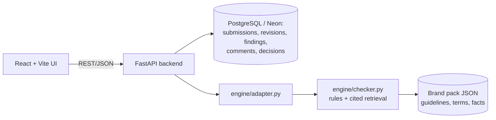

[README-4.md](https://github.com/user-attachments/files/34916386/README-4.md)
# Inkloom AI

**Catch brand and compliance problems before content goes public, with the exact guideline behind every flag and a human making every approval.**

[Live demo](https://brand-governance-ai.vercel.app/) · [Repository](https://github.com/gmraarush210-blip/brand-governance-ai) · [Testing log](docs/testing_log.md) · [Architecture](docs/architecture.md) · [Responsible design](docs/privacy_security.md)

---

## The problem

Companies now publish through many people, agencies and AI tools. Brand rules live in scattered documents, review is manual and late, and generic AI tools write fluent text that nobody can verify. Prohibited claims, outdated facts, leaked contact details and accessibility gaps reach the public before anyone notices.

## What Inkloom does

Paste a draft or upload a PDF. In seconds you get findings that each show **what is wrong, which guideline says so, and how to fix it**. Risky items go to a manager or reviewer. Nothing is ever rewritten silently or published automatically.

**A real finding from the tool:**

> **[HIGH] terminology**: "cures" is a prohibited term: it implies a guaranteed or curative outcome.
> **Source:** Acme Wellness Brand Pack, 2.2 Health and Outcome Language (v1.0, 2026-01-15)
> **Suggested fix (optional):** Replace with "supports".

### What it checks

| Check | Example it catches |
|---|---|
| Prohibited wording | "cures", "guarantees" |
| Unsupported absolute claims | "100%", "zero errors", "best in class", "fastest in the world" |
| Stale facts | Draft says "Founded in 2015"; the approved fact sheet says 2019 |
| Brand name | "ACME" instead of "Acme" |
| Personal data | Emails and phone numbers, **masked in the output** so the tool never repeats them |
| Accessibility | Images with no alt text; sentences averaging over 25 words |

### Why it is different

- **Evidence over confidence.** Every finding cites a guideline section with its version and date. When no source exists, it says **"No source found"** instead of implying the text is fine.
- **Humans decide.** Creators cannot resolve high-risk findings. Approval is blocked while any high-risk finding is open. There is no publish step.
- **Works without AI.** The rule engine is deterministic and runs offline. No draft text is sent to any external AI service.
- **Full audit trail.** Every edit is a new revision, the original is always kept, and every decision is recorded with the role and a timestamp.
- **Learns from use.** The Insights tab shows recurring issues, the most-rejected rules (a sign a guideline may be unclear), and findings with no source.

---

## Try it in 60 seconds

1. Open the [live demo](https://brand-governance-ai.vercel.app/) and click **Continue as creator**.
2. On **Upload**, paste this and press **Submit & review**:
   Example:

   ```
   ACME Sleep Tonic cures insomnia and guarantees a perfect night's rest. It is the best in class, with 100% satisfaction. Founded in 2012.

   

   Questions? Email jane.doe@gmail.com or call +91 98765 43210 today.
   ```
4. Read the cited findings. Notice the email and phone number appear masked.
5. As creator, try to **Accept** a High finding. The server refuses.
6. Click **Switch role / sign out**, choose **Continue as reviewer**, open the **Review Queue**, resolve the High findings, then **Approve**.
7. Scroll to the **audit trail**. Edit the draft, save a new revision, and watch the findings clear.

## Roles

| Role | Can do |
|---|---|
| creator | Submit, edit, resolve low and medium findings |
| manager | Resolve high-risk findings; approve, request changes or escalate |
| reviewer | Same as manager, with a queue filtered to high-risk findings |

Roles are demo identities with no password, so judges can switch in one click. The server enforces the role rules, but it trusts the role the client sends; this is not production authentication (see Limitations).

---

## How it works



1. **Submit:** text or PDF (extracted with `pypdf`) is stored as revision 1.
2. **Review:** the engine returns validated findings: type, severity, excerpt, explanation, cited source, suggested fix, uncertainty label.
3. **Resolve:** accept or reject each finding with a reason; edits create new revisions.
4. **Approve:** a manager or reviewer records a decision, enforced on the server.
5. **Learn:** Insights aggregates patterns without ranking any employee.

## Responsible by design

| Concern | What we did |
|---|---|
| Personal data | Detected and masked in findings; raw values are never echoed |
| Prompt injection | Draft text is treated as data; instructions inside it are never executed (tested) |
| False positives and misses | Evidence and an uncertainty label on every finding; reject-with-reason feeds Insights; not a legal, factual or accessibility certification |
| Human authority | No auto-approval, no auto-publish, no silent rewriting |
| Fairness | No demographic inference; insights are descriptive only |
| Accessibility | Keyboard-operable, labelled inputs, announced errors |

Full write-up: [docs/privacy_security.md](docs/privacy_security.md) · AI tools and data disclosure: [docs/ai_disclosure.md](docs/ai_disclosure.md)

## Tested against hostile input

We attacked our own tool: empty and whitespace input, double-clicks, retries after failure, page refreshes, wrong and oversized files, scanned PDFs, a stopped backend, and pathological text. That pass found and fixed real bugs. For example, a 200,000-digit paste used to hang the review engine for minutes, and now returns in well under a second. Every bug and fix is in the [testing log](docs/testing_log.md), along with a manual checklist anyone can repeat.

---

## Run it locally

Prerequisites: **Python 3.10+** and **Node 18+**.

```bash
git clone https://github.com/gmraarush210-blip/brand-governance-ai.git
cd brand-governance-ai

# 1. Backend  (terminal 1)
python -m venv .venv
source .venv/bin/activate            # Windows: .venv\Scripts\activate
pip install -r requirements.txt
INKLOOM_ENGINE=builtin uvicorn main:app --reload --port 8000
#   Windows PowerShell:  $env:INKLOOM_ENGINE="builtin"; uvicorn main:app --reload --port 8000

# 2. Frontend (terminal 2)
cd frontend
npm install
npm run dev
```

Open **http://localhost:5173**. Check the API at http://localhost:8000/api/health (interactive docs at `/docs`).

> The backend does not read `.env` by itself, so set variables in the shell as shown above.

### Configuration

| Variable | Default | Purpose |
|---|---|---|
| `INKLOOM_ENGINE` | `auto` | `builtin` forces the bundled rule engine |
| `DATABASE_URL` | Neon integration | PostgreSQL connection string for persistent storage |
| `CORS_ORIGINS` | localhost:5173,3000 | Comma-separated browser origins allowed to call the API |
| `VITE_API_URL` (frontend) | `http://localhost:8000` | Where the frontend finds the API |

### Tests

The API tests create and delete submissions. Set `TEST_DATABASE_URL` to a **dedicated test database** before running the suite; API tests skip when it is missing and fail if it exactly matches `DATABASE_URL`.

```bash
pip install -r requirements.txt
export TEST_DATABASE_URL="<dedicated test database URL>"
python -m pytest tests -v
```

### Troubleshooting

| Symptom | Fix |
|---|---|
| "Cannot reach the server" in the UI | Backend not running, or `VITE_API_URL` points elsewhere |
| Browser console shows a CORS error | Add your frontend origin to `CORS_ORIGINS` |
| Port 8000 or 5173 busy | Change `--port` / set `VITE_API_URL`; add the new frontend port to `CORS_ORIGINS` |
| PDF says "no extractable text" | The PDF is scanned images; paste the text instead |
| `ModuleNotFoundError` | Activate the virtualenv and rerun `pip install -r requirements.txt` |

## Project layout

```
main.py               FastAPI app (entry point)
routes/               submissions, approvals, insights endpoints
engine/               rule checker, PDF extractor, output formatter, adapter
data/                 fictional brand pack (guidelines + approved facts)
database.py           Neon Postgres connection pool
frontend/             React + Vite UI (login, upload, findings, queue, insights)
tests/                engine and API tests
docs/                 architecture, privacy, testing log, demo script, AI disclosure
```

`backend/main.py` is an older standalone app that is not used by the steps above.

## Roadmap

- **Next:** real authentication with server-issued sessions; automated frontend tests; CI running both suites.
- **Pilot:** user interviews and a short survey, then measure review completion, repeated-issue rate and perceived usefulness against a baseline.
- **Later:** ingest real brand documents, image and asset checks, per-brand packs with fact expiry, and optional model-assisted explanations behind a disclosed provider with the rule path as fallback.

## Limitations (stated plainly)

- Roles are not real authentication (see Roles). Brand data is fictional.
- Rule-based checks can miss issues and flag harmless text. They are not legal, factual or accessibility certification.
- Scanned PDFs are not read (no OCR).
- `DATABASE_URL` must be configured in each Vercel project and environment that serves the API.
- No primary user research has been collected yet; the problem statement comes from the event brief.

## Team

| Role | Owner |
|---|---|
| AI Review Engine Lead | M Tejas Navada |
| Backend and Workflow Lead | Aarush C U |
| Frontend and UX Lead | K H Varun |
| Research, Data and Documentation Lead | Karthik R |

Details in [docs/team_and_contributions.md](docs/team_and_contributions.md).

## License

Released under the [MIT License](LICENSE). Copyright (c) 2026 Code Catalysts.
