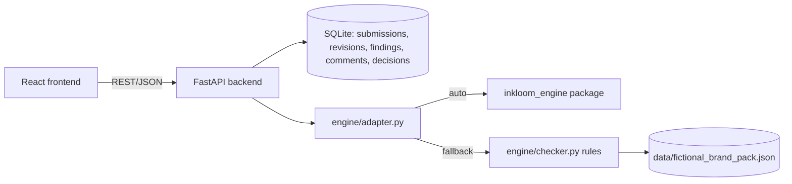

# Architecture

## Flow
1. **Submit**: creator pastes text or uploads a PDF (`pypdf` extraction); stored as revision 1.
2. **Review**: `run_review()` returns structured findings (issue type, severity, excerpt, explanation,
   cited source + version/date, suggested fix, uncertainty label). Output is validated in `engine/formatter.py`.
   If no source applies the finding says "No source found".
3. **Resolve**: creator accepts/rejects/comments or edits (new revision; original preserved).
4. **Approve**: manager/reviewer records approve / request changes / escalate. Approval is blocked while
   High/Critical findings are open. There is no publish step.
5. **Learn**: `/api/insights` aggregates issue types, most-rejected rules and findings without a source.

## Key decisions
- Evidence-linked over confident: missing evidence = "No source found", never "correct".
- Rule path works with no AI service; any model use is optional and disclosed.
- Role checks are enforced server-side (prototype roles are a switcher, not real authentication).
